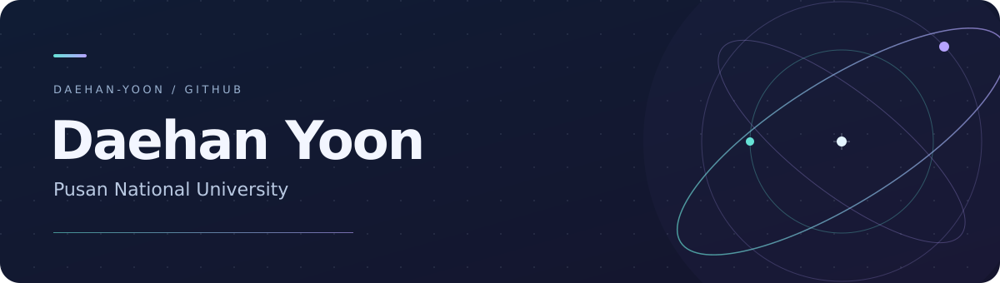

  

  <a href="https://github.com/daehan-yoon?tab=repositories"><strong>Projects ↗</strong></a>
  &nbsp;&nbsp;·&nbsp;&nbsp;
  <a href="https://solved.ac/profile/j952225"><strong>Problem solving ↗</strong></a>
  &nbsp;&nbsp;·&nbsp;&nbsp;
  <a href="https://github.com/daehan-yoon?tab=stars">On my radar ↗</a>

 

<h3>Hello, I'm Daehan.</h3>

I'm at <strong>Pusan National University</strong>. Welcome to my corner of GitHub — a home for my projects, notes, and work in progress.

<!-- ABOUT: Add your department, degree program, or current role here.
Keep the introduction to two or three sentences.
-->

 

<h3>Tech stack</h3>

<h4>Languages</h4>

  
  
  
  
  
  

<h4>Machine learning &amp; robotics</h4>

  
  
  
  

<h4>Web &amp; development</h4>

  
  
  
  

<!-- TECH STACK: Add or remove individual  tags in the groups above.
The badges describe tools I use; the language card below reflects repository data.
-->

 

<h3>GitHub activity</h3>

  
  

<!-- STATS: These cards update through GitHub Profile Summary Cards.
The language card measures languages by repository, not proficiency.
It can be empty until code repositories have language data.
-->

 

<h3>Problem solving</h3>

  

<a href="https://www.acmicpc.net/user/j952225">Baekjoon ↗</a> &nbsp;·&nbsp; <a href="https://solved.ac/profile/j952225">solved.ac ↗</a>

 

<h3>Selected work</h3>

Projects will appear here as they become ready to share.

<!-- PROJECTS: Replace the sentence above with two to four entries:

#### [Project name](https://github.com/daehan-yoon/REPOSITORY)
One sentence describing the problem, what you built, and why it matters.

`Main technology` · `Topic` · [Demo](URL) · [Read more](URL)

Remove unavailable links.
-->

<!-- RESEARCH: Remove this comment wrapper when ready.

## Research interests
- **Topic** — A specific question or problem you are interested in.
- **Topic** — A specific question or problem you are interested in.

-->

<!-- PUBLICATIONS: Remove this comment wrapper when there is an item to list.

## Publications
**Paper title**  
Authors · Venue, Year  
[Paper](URL) · [Code](URL)

-->

 

Daehan Yoon &nbsp;·&nbsp; Pusan National University

